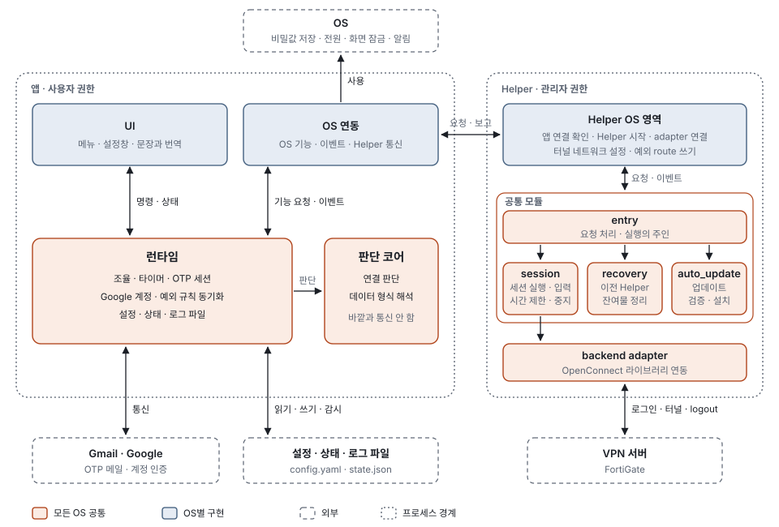

# FortiVPNManager 기능 명세

# 0. 문서 정보
- 목적: 사용자가 보는 동작과 외부에 대한 보장(보안, 설정 파일, 저장 데이터)의 기준
- 범위
  - macOS + openconnect(기본) 또는 openfortivpn, Windows + openconnect
- OS 표기
  - Keychain: 각 OS의 비밀값 저장소(Windows는 Credential Manager)
  - OS·VPN client별 차이만 별도 기재

| 용어 | 뜻 |
|---|---|
| Connection Manager | 연결 state machine과 그 실행 부분(규칙은 판단 코어, 실행은 런타임) |
| 시도 | 연결됨 또는 실패로 끝나는 연결 시도 한 번 |
| 연결됨 | 서버가 준 모든 VPN route에서 OS가 실제로 고르는 route가 현재 세션의 터널 장치 경유, 터널 IPv4 주소는 그 장치에만 존재 |
| 실행 | Helper에서 VPN client 프로세스 하나가 살아 있는 기간, 동시에 하나 |
| 진행 단계 (milestone) | 실행됨 → 게이트웨이 연결(인증서 확인) → OTP prompt → OTP 제출 → 인증됨 → 터널 올라옴 |
| 종료 사실 | 실행 종료 시 Helper의 기록(가장 멀리 간 단계, 종료 주체, 종료 코드 등) |
| 멈춤 | 자동 재시도 없이 사용자의 [연결]을 기다리는 상태 |
| 도메인 구역 | UI로 보내는 상태 단위: 연결, 스케줄, 준비 상태·Helper, Gmail·Google 계정, 예외 규칙, 설정 |

# 1. 시스템 구성

## 1.1 전체 구성

- 그림
  - 앱과 Helper: 별도 프로세스
  - 화살표: 서로 주고받는 내용
  - 공통 계약: 양쪽 공통 약속이라 그림에서 제외
  - 기준: macOS 구성
  - Windows: 앱 쪽 동일, Helper 쪽은 세 모듈과 Helper OS 영역 (Windows)이 Helper 서비스 하나로 실행

| 구성 요소 | 위치 | 역할 |
|---|---|---|
| UI (macOS) | 앱 | 메뉴바와 설정창, 사용자에게 보이는 모든 문장과 번역 |
| OS 연동 (macOS) | 앱 | OS 기능 제공, 시스템 이벤트 전달, Helper와의 통신 |
| 런타임 | 앱 | 조율, 타이머, OTP 세션, Google 계정, 설정·상태·로그 파일, 예외 규칙 동기화 |
| 판단 코어 | 앱 | Connection Manager 규칙과 데이터 형식 해석, 바깥과 직접 통신 없음 |
| 공통 계약 | 앱·Helper | 앱과 Helper가 주고받는 내용, VPN client 처리가 지킬 약속 |
| backend adapter | Helper(일부는 앱) | VPN client별 처리(openfortivpn, openconnect) |
| process 모듈 | Helper | VPN client 확인과 실행, 비밀번호·OTP·cookie 입력, 출력 처리, 시간 제한, 종료 |
| recovery 모듈 | Helper | 실행 기록과 예외 route 기록, 이전 Helper가 남긴 프로세스와 예외 route 정리, route 복구 요청 |
| entry 모듈 | Helper | 앱 요청 처리, 실행과 예외 route의 주인 판단, Helper 수명 |
| Helper OS 영역 (macOS) | Helper | 앱 연결 확인, Helper 실행 관리와 자가 업데이트, route 복구와 예외 route 넣기·지우기 |
| UI (Windows) | 앱 | 알림 영역 아이콘과 설정창, 사용자에게 보이는 모든 문장과 번역 |
| OS 연동 (Windows) | 앱 | OS 기능 제공, 시스템 이벤트 전달, Helper와의 통신 |
| Helper OS 영역 (Windows) | Helper | Helper 서비스로 실행, 세 모듈 사용, 서비스 수명, 앱 연결 확인, route 정리, 예외 route 넣기·지우기 |
| 설치 패키지 (Windows) | 설치·제거 때 | 앱, Helper, OpenConnect 설치와 업그레이드, Helper 서비스 등록, 제거 때의 정리 |
| openfortivpn | Helper가 실행 | macOS에서 고를 수 있는 VPN client와 pppd |
| openconnect | Helper가 실행 | Windows와 macOS(기본)의 VPN client, VPN 터널 정보 스크립트, 앱과 함께 설치 |
| Gmail · Google | 외부 | OTP 메일, 계정 인증 |
| config.yaml · state.json · 로그 파일 | 사용자 디스크 | 설정, 기기별 상태, 실행 로그 |
| macOS · Windows | OS | 비밀값 저장, 서비스 실행, 전원·화면·네트워크 이벤트, routing table |

- Helper: 관리자 권한으로 VPN client를 실행하는 별도 프로세스
  - 구성: entry·process·recovery 모듈(두 OS 공통) + 해당 OS의 Helper OS 영역
- (macOS)·(Windows) 표기: 해당 OS 전용 구성 요소, 표기 없는 것은 모든 OS 공통
- 본문: OS 표기 생략

## 1.2 구성 요소 사이의 연결
- 앱 ↔ Helper
  - 같은 기기 안의 서로 확인한 연결 한정
  - 앱 → Helper: 실행 요청, OTP, 연결 해제
  - Helper → 앱: 진행 단계, 출력, 종료 보고
- 외부
  - 앱 ↔ Gmail·Google: OTP 메일 확인, 계정 인증
  - Helper의 VPN client ↔ VPN 서버: 로그인, 터널, logout

# 2. 구성 요소별 설명

## 2.1 공통 계약
- 설명: 앱 쪽·Helper 쪽·backend adapter의 공통 약속, 앱과 Helper 양쪽 메시지 작성·해석 기준
- 역할
  - 실행 요청, 진행 단계, prompt 종류, 종료 사실, Helper 오류의 정의
  - VPN client 처리의 필수 기능 목록, 메시지 송수신 규칙, IPv4 값 규칙
- 제공 기능: 없음(다른 구성 요소가 쓰는 정의 제공)

## 2.2 판단 코어
- 설명: 앱의 모든 판단과 데이터 형식 해석, 바깥과 직접 통신 없음
  - 같은 입력·순서에 항상 같은 결과
- 역할
  - Connection Manager 규칙, 표시 값, 준비 상태 판정
  - 예외 규칙 계산, config.yaml·IMAP·Gmail API·OAuth·OTP 메일 형식
- 제공 기능: 3.1 연결 관리, 3.2 설정, 3.5 예외 규칙, 4.4 config.yaml

## 2.3 런타임
- 설명: 앱 안의 조율과 OS 무관 외부 작업, 판단 코어가 정한 작업 실행
- 역할
  - 이벤트 처리, 타이머, Helper 요청 순서, 도메인 구역 전송
  - OTP 세션, Google 계정, config.yaml·state.json·로그 파일, 예외 규칙 동기화
- backend adapter 사용 범위: 설정 가져오기, 인증서 값 형식, 계정 값 확인 한정
- 제공 기능: 3.2 설정, 3.3 OTP, 3.4 Google 계정, 3.5 예외 규칙, 3.6 저장·기록

## 2.4 backend adapter
- 설명: 특정 VPN client 전용 처리 모음, openfortivpn·openconnect의 같은 인터페이스 사용
- 역할
  - 실행 파일·버전 확인, 실행 요청 검증, 설정 파일·argv 생성
  - 출력 해석, 종료 유예 시간, 세션 cookie·logout 요청, 기존 설정 읽기, 인증서 값 형식
  - 여러 OS용 VPN client의 OS별 차이(실행 파일 위치, 환경 변수, 일부 출력 문구)
- 제공 기능: 3.7 VPN 실행

## 2.5 process 모듈
- 설명: Helper 안의 VPN client 담당, client 확인과 시도 하나의 실행 준비부터 종료까지 관리
  - 로그인·터널 분리 client: 두 프로세스 순차 실행
  - VPN client별 차이: backend adapter에 위임
- 역할
  - client 확인, 실행 명세·설정 파일 준비, OTP 형식 확인
  - 프로세스 실행, stdin 입력, 출력 줄 조립
  - 단계별 시간 제한, 종료, 종료 사실 기록
  - Windows Helper 시작 시 시간 제한 없는 client 확인 1회
  - 네트워크 설정 적용·원복 요청(적용 실패 시 재시도)
- 제공 기능: 3.7 VPN 실행

## 2.6 recovery 모듈
- 설명: Helper 비정상 종료 대비 실행·예외 route 기록, 다음 Helper 시작 시 그 기록으로 정리
  - VPN client 관련 처리: process 모듈이 넘긴 backend adapter에 위임
- 역할
  - 실행 기록, 예외 route 기록
  - 이전 Helper가 남긴 프로세스 정리
  - 이전 실행이 남긴 route·네트워크 설정·예외 route 복구 요청
- 제공 기능: 3.5 예외 규칙, 4.7 사용자 시스템

## 2.7 entry 모듈
- 설명: Helper의 OS 무관 앞단, 앱 요청 접수와 허용 판단
  - VPN client 관련 처리: process·recovery 모듈에 위임
  - 상태 응답: process 모듈 제공 정보 기반
- 역할
  - 앱 연결, 실행 하나와 그 주인 관리, 응답 생성
  - 앱 연결별 원하는 예외 route와 Helper가 넣은 예외 route 관리, 넣고 지울 route의 OS 쪽 전달
  - 이전 Helper 잔여물 정리·route 복구 완료 전 앱 연결 차단, 실행이 요청한 route 복구의 OS 쪽 전달
  - Helper 종료 판단, Helper 로그
- 제공 기능: 3.5 예외 규칙, 3.7 VPN 실행

## 2.8 UI (macOS)
- 설명: 도메인 구역의 화면 표시, 사용자 조작의 명령 전송, 사용자에게 보이는 모든 문장과 번역 생성
- 역할
  - 메뉴바 아이콘, 메뉴, 설정창 pane
  - 종류·값 기반 문장 생성과 번역, 상대 시간 표시
- 제공 기능: 3.8 macOS

## 2.9 OS 연동 (macOS)
- 설명: 런타임이 요청한 OS 기능의 macOS 제공, 시스템 이벤트 전달
- 역할
  - 비밀값 저장, Helper 등록·통신, 알림, 브라우저 열기, 앱 수명
  - 시스템 이벤트, 네트워크 정보
- 제공 기능: 3.8 macOS

## 2.10 Helper OS 영역 (macOS)
- 설명: Helper 프로세스의 OS 의존 부분, 앱 쪽 OS 연동에 대응, 나머지는 entry 모듈에 전달
- 역할
  - 앱 연결 접수와 서명 확인, Helper 실행 관리와 자가 업데이트
  - route 복구, entry 요청에 따른 예외 route 추가·삭제와 주 네트워크 조회
  - 터널 네트워크 설정 적용·원복
- 제공 기능: 3.7 VPN 실행, 3.8 macOS

## 2.11 UI (Windows)
- 설명: UI (macOS)와 같은 역할의 Windows 구현
  - 사용자에게 보이는 구성(창, 메뉴, pane과 순서, pane 선택 방식, pane 안 항목의 섹션과 순서): macOS와 동일
  - 컨트롤: Windows 기본 컨트롤
- 역할
  - 알림 영역 아이콘과 메뉴, 설정창 pane
  - 종류·값 기반 문장 생성과 번역, 상대 시간 표시
- 제공 기능: 3.9 Windows

## 2.12 OS 연동 (Windows)
- 설명: 런타임이 요청한 OS 기능의 Windows 제공, 시스템 이벤트 전달, 런타임과의 메시지는 macOS와 동일
- 역할
  - 앱 시작 시 Helper 서비스 시작과 대기
  - 비밀값 저장, Helper 서비스와의 통신, 알림, 브라우저 열기, 앱 수명
  - 시스템 이벤트, 네트워크 정보
- 제공 기능: 3.9 Windows

## 2.13 Helper OS 영역 (Windows)
- 설명: Windows의 Helper OS 영역, Helper 서비스로 실행, entry·process·recovery 모듈 사용, macOS Helper OS 영역의 일을 직접 수행
- 역할
  - 서비스 수명(실행 중 알림 전 process 모듈의 VPN client 확인 포함), 앱 연결 접수·확인
  - process 모듈용 backend adapter(openconnect)와 실행 기록 폴더 선택
  - 게이트웨이 host route 정리, entry 요청에 따른 예외 route 추가·삭제와 주 interface 조회
  - 터널 네트워크 설정 적용·원복
- 제공 기능: 3.7 VPN 실행, 3.9 Windows

## 2.14 설치 패키지 (Windows)
- 설명: Windows 앱의 설치·업그레이드·제거용 MSI 설치 패키지, 관리자 권한 실행
- 역할
  - 앱, Helper, OpenConnect 설치와 업그레이드
  - Helper 서비스, 이벤트 로그 출처, 시작 메뉴 바로 가기 등록
  - 제거 시 앱이 PC에 넣은 것(로그인 시 열기, Helper와 실행 기록) 정리
- 제공 기능: 3.9 Windows

# 3. 동작

## 3.1 연결 관리
- [연결]·[연결 해제]·[지금 재연결]·[종료]: 연결 시작, 끊기, 다시 연결, 터널 종료 후 앱 종료
- 끊긴 연결
  - 서버 세션 종료·네트워크 문제: 대기 후 재시도
  - 서버 세션 종료: 연결 뒤 서버의 세션 종료·세션 거부 응답 한정
  - 네트워크 문제: 인증 실패·서버 세션 종료가 아닌 종료
  - Helper 연결 끊김: 즉시 재연결
  - 인증 실패: 대기 후 1회 재시도
    - 대상: 서버의 비밀번호·OTP 재요청, 제한 시간 안 OTP 메일 미수신
    - 대상(로그인 후): 인증서 불일치, 터널 장치 준비 실패
- 멈춤: 인증 실패 반복, Gmail 인증 실패, 자동 시도 상한 도달
- 사전 재연결: 서버가 세션을 끊기 전, 정한 시각에 다시 연결
- 다시 연결(openconnect): 기존 연결을 유지한 채 새 연결 준비 후 전환, 준비 실패 시 기존 연결 유지, 준비 중 표시는 [지금 재연결]만 진행 표시, 자동 다시 연결은 기존 연결 기준
- 잠자기·네트워크 변화: 깨어난 뒤 터널과 경로가 그대로면 유지, 경로가 바뀌면 재연결, 네트워크가 없으면 복귀까지 대기, 시계·시간대 변경 시 예정 시각 재계산
- 연결 확인: 연결됨 여부를 OS의 route·주소 정보 읽기로만 판정, 통신 영향 없음
  - 시점: 연결 직후, 사전 재연결 전환 후, VPN 내부 재연결 후 재적용, 잠자기 해제·네트워크 경로 변경 후
  - 실패: 연결·전환 때는 네트워크 설정 실패로 처리, 잠자기 해제·경로 변경 때는 터널 유실로 재연결
- 스케줄과 자리 비움: 요일별 시작 시각에 자동 연결, 앱 시작 시 자동 연결은 스케줄 시간 안 한정, 종료 시각 뒤에도 연결 유지, 자리 비움 중 재연결 보류, 정한 시간이 지나면 자동 재연결 중단
- 상태 표시: 연결 상태 아이콘, 연결 시각·터널 IP·다음 재연결 시각·대기 이유·진행 단계, 빠진 설정 항목 안내, 오류 안내에 외부(Google, IMAP 서버, Helper) 설명 포함

## 3.2 설정
- config.yaml: 직접 편집 가능, 앱 재시작 없이 반영, 설정창 변경도 같은 파일에 저장
- VPN 비밀번호: 빈 칸으로 저장하면 기존 값 유지
- 기존 설정 가져오기: 첫 실행 때 자동, 일반 pane에서 직접 실행, macOS는 openfortivpn 설정, Windows는 FortiClient 연결(서버 주소 한정)
- VPN client 선택: macOS 고급 pane

## 3.3 OTP
- 대상 메일: OTP 요청 뒤 도착한 OTP 메일 중 가장 늦은 것
- 방식: Gmail API(기본, Google 계정 연결) 또는 IMAP(앱 비밀번호), Google 계정을 쓸 수 없고 앱 비밀번호가 있으면 IMAP으로 전환
- 사용한 OTP 메일: 휴지통으로 이동, OTP 메일이 스팸함에 있으면 안내
- Gmail 연결 테스트(계정 pane): 연결 상태와 실패 기록에 영향 없음

## 3.4 Google 계정
- 브라우저의 Google 로그인으로 연결, 설정한 Gmail 주소와 다른 계정이거나 권한이 부족하면 거부와 이유 안내
- Google이 연결을 거부하면 다시 연결 안내

## 3.5 예외 규칙
- 지정한 네트워크에 있을 때 지정한 host·대역은 VPN 대신 그 네트워크의 router로 통신
- IP로 적은 VPN 서버 주소 자체는 예외 대상 불가(설정 오류)
- 예외 규칙 pane: 행별 문제 표시, [적용]으로 저장
- route 추가 실패가 반복되면 알림 1회

## 3.6 저장·기록
- 로그 pane과 로그 파일: VPN client 원본 출력과 앱·Helper 설명 줄, 시도마다 구분
- 시도에 속한 줄: 10자리 세션 ID로 시작, Helper 로그의 실행 줄에도 같은 ID
- 실행마다 첫 줄에 VPN client 이름과 버전
- [모두 복사]: 로그 파일과 같은 형식, [지우기]: 화면만 비움
- 로그인 시 열기: 설치 후 첫 실행 때 한 번 켜기, 이후 사용자 선택 유지

## 3.7 VPN 실행
- VPN client가 비밀번호·OTP를 다시 물으면 즉시 종료(서버 거부)
- 진행하지 못하는 연결: 단계별 시간 제한 후 종료
- 중지: logout은 openconnect 처리, 중지 후 10초 안에 끝나지 않으면 logout 없이 종료, 30초 안에 세션이 끝나지 않으면 Helper 재시작
- Helper 내부 멈춤: 30초 응답 없으면 Helper 재시작
- VPN client가 없거나 쓸 수 없으면 안내, 검증되지 않은 버전이면 고급 pane에 경고
- macOS 앱 업데이트: 연결이 없을 때 새 Helper로 교체
- openconnect 네트워크 설정: 서버가 준 값의 Helper 적용

## 3.8 macOS
- 메뉴바 아이콘과 메뉴, 설정창(일반·계정·연결 관리·예외 규칙·고급·로그 pane), 사이드바와 설정 검색
- 메뉴와 일반 pane의 [연결]·[연결 해제]·[지금 재연결]: 항상 표시, 쓸 수 없으면 흐리게
- Helper 승인·버전 상태: 고급 pane에 안내
- VPN client를 찾을 수 없을 때: openfortivpn은 설치 안내, openconnect는 앱 재설치 안내
- openconnect DNS: 서버가 준 도메인만 VPN DNS로 조회, full tunnel이면 모든 조회에 사용

## 3.9 Windows
- 알림 영역 아이콘(상태는 툴팁·메뉴), 클릭 시 메뉴, 더블클릭 시 설정창, 설정창은 macOS와 같은 pane·순서
- 설정창을 닫아도 앱 유지, 앱 종료는 메뉴 [종료] 한정, Windows 로그아웃·종료 시 [종료]와 같은 동작
- 앱 시작: Helper 서비스가 실행될 때까지 아이콘 미표시, 서비스를 시작할 수 없으면 이유와 조치(재설치·관리자 문의) 안내 후 앱 종료
- 설치: MSI 하나(앱·Helper·OpenConnect), PC 전체 설치, 한국어·영어
- 업그레이드·제거: 실행 중인 앱 종료 후 진행, 업그레이드 뒤 앱은 사용자가 열 때까지 닫힘, 낮은 버전 설치 거부
- Helper 승인 항목·VPN client 선택 없음, OpenConnect가 없으면 재설치 안내

# 4. 외부 보장
- 내부 오류: 즉시 중단과 crash report(Windows Helper는 이벤트 로그 오류 기록)
- 앱·Helper 로그: 영어

## 4.1 보안
- Helper 연결: 같은 기기에서 서명이 확인된 앱 한정
- 비밀번호·OTP·route를 바꾸는 요청: 같은 빌드로 확인된 앱 한정
- 앱 요청: Helper의 모든 값 재검사, 그 OS가 실행할 수 없는 VPN client 요청 거부
- VPN client 실행: 동시에 하나(openconnect 교체 준비 중에는 기존 실행과 새 실행 하나), 다른 사용자의 요청 거부
- 실행 파일: openconnect는 앱과 함께 설치된 것, openfortivpn은 Homebrew 설치본 한정, 따로 설치된 OpenConnect는 사용·변경 없음
- 앱 연결이 끊긴 경우(정상 종료·강제 종료·크래시): 그 앱의 VPN 실행과 그 앱만 원하던 예외 route 정리
- Windows Helper 서비스: 정지·설정 변경·삭제는 관리자 한정
- 게이트웨이 인증서: 확인 질문 없이 자동 신뢰

## 4.2 비밀값
- 비밀번호, OTP, token, client secret, VPN 세션 cookie: 명령줄 인자·파일·환경 변수·로그 기록 금지, Helper에는 앱–Helper 연결로만 전달
- 보관: VPN 비밀번호와 Google 인증 정보는 OS 비밀값 저장소, access token은 메모리 한정
- 로그: VPN client 원본 출력은 세션 ID 뒤에 그대로 기록, 앱·Helper 설명 줄에는 비밀값과 설정 내용 미기록
- Google 계정 연결: 이 기기 안에서만 응답 수신, 조건이 맞지 않는 token 철회, 연결 해제 시 token 삭제와 철회 요청

## 4.3 파일 권한
- config.yaml·state.json·로그 파일: macOS 0600(config.yaml이 0600이 아니면 경고), Windows 사용자 profile 기본 권한
- openfortivpn 설정 파일: 0600, 비밀번호 미기록, 실행 종료 후 삭제
- VPN 터널 정보 파일: 관리자(root·SYSTEM) 전용 폴더, Helper가 읽은 직후 삭제

## 4.4 config.yaml
- 두 OS 공용 형식, 앱이 쓰는 설명 주석은 해당 OS 기준
- 엄격한 읽기: 오류 하나를 위치와 함께 보고, 마지막 정상 설정 유지, 연결 차단
- 알 수 없는 키, 잘못되거나 중복된 인증서 값, 중복된 예외 규칙 항목: 경고 후 무시
- 적지 않은 키와 파일 없음: 기본값, symlink는 따라감
- 더 새로운 schema_version: 거부, 그 파일 덮어쓰기 금지
- 앱의 쓰기: 최신 파일에 바뀐 값만 반영, 원자적 쓰기, symlink 유지, 사용자가 단 주석은 유지되지 않음
- VPN client: macOS는 openconnect(기본)·openfortivpn, 다음 연결부터 적용, Windows는 항상 openconnect
- DTLS(openconnect): 기본 끔, config.yaml로만 켬, 다음 연결부터 적용
- 서버 인증서 값: VPN client별 목록, 학습한 값 자동 추가(최대 4개), 서버 주소·port 변경 시 초기화
- 예외 규칙 목록: 설정창과 config.yaml로만 지정

## 4.5 저장 데이터
- state.json·비밀값 저장소 항목·로그 파일·앱–Helper 버전 확인: 이전·다음 빌드가 서로 읽을 수 있는 형식 유지
- state.json
  - 파일 읽기 실패: 빈 상태로 시작
  - 알 수 없거나 잘못된 값: 그 값만 없는 것으로 처리
- 로그 파일: VPN client와 무관한 하나의 파일, 크기 초과 시 회전

## 4.6 서버
- VPN 세션: Helper 비정상 종료로 logout하지 못한 세션은 다음 Helper 시작 때 logout 요청

## 4.7 사용자 시스템
- 예외 route: 앱이 VPN을 켜 두려 하는 동안만 추가, 그 밖과 앱 종료 시 삭제, Helper가 넣은 것만 삭제
- 이전 버전이 OS 설정에 저장한 예외 route: 읽기·삭제 없음
- 터널 네트워크 설정: 실행 종료 시 Helper가 넣은 것만 원복
  - 원복 실패 시: 다음 세션 시작 전(교체 연결 제외)·Helper 시작 때 재원복
- macOS DNS: Wi-Fi 등 저장된 네트워크 설정 미변경
- Helper 비정상 종료 뒤 다음 시작 때 정리
  - 대상: 이전 실행의 VPN client 프로세스, route, 네트워크 설정
  - 다른 프로세스 미변경
- 설정 가져오기 원본(openfortivpn 설정, FortiClient 연결): 읽기 전용
- Windows 제거: 앱이 넣은 것 삭제, 사용자별 설정·상태·로그·비밀값 유지
