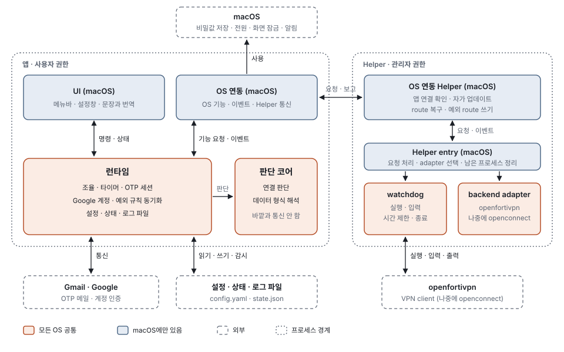

# FortiVPNManager 기능 명세

시스템이 하는 일을 구성 요소와 기능 단위로 정한다. 왜 이렇게 만들었는지는 [DESIGN.md](DESIGN.md), 진행 중인 Rust 사전 리팩토링은 [REFACTOR-PLAN.md](REFACTOR-PLAN.md)를 본다.

# 0. 문서 정보

- **목적**: 구현과 검증의 기준이 되는 기능 명세다. 기능이 바뀌면 이 문서를 먼저 고친다.
- **범위**: macOS와 openfortivpn backend. openconnect와 Linux·Windows는 들어갈 자리만 둔다.
- **숫자**: 사용자에게 보이는 규칙일 때만 적는다. 그 밖의 시간 값과 횟수는 코드가 기준이다.
- **기술**: 어떤 기술로 만드는지는 이 문서에 적지 않는다. 지켜야 할 외부 제약일 때만 적는다. 구조와 기술 결정은 DESIGN.md를 본다.

| 용어 | 뜻 |
|---|---|
| Connection Manager | 연결 state machine과 그것을 돌리는 부분(규칙은 판단 코어, 실행은 런타임) |
| 시도 | 연결됨이나 실패로 끝나는 연결 시도 한 번. 시도 ID로 구분한다 |
| 실행 | Helper에서 VPN client 프로세스 하나가 살아 있는 기간. 한 번에 하나다 |
| 진행 단계 (milestone) | 실행됨 → 게이트웨이 연결 → OTP prompt → OTP 제출 → 인증됨 → 터널 올라옴 |
| 종료 사실 | 실행이 끝날 때 Helper가 남기는 기록(가장 멀리 간 단계, 종료한 주체, 터널 유지 시간 등) |
| 안정 세션 | 정해진 시간 이상 유지된 터널 |
| 멈춤 | 자동 재시도 없이 사용자의 [연결]이나 [지금 재연결]을 기다리는 상태 |
| 도메인 구역 | UI로 보내는 상태 단위: 연결, 스케줄, 준비 상태·Helper, Gmail·Google 계정, 예외 규칙, 설정 |
| port | 공통 부분이 OS 기능을 요청하는 인터페이스. 구현은 OS마다 따로 한다 |

# 1. 시스템 구성

## 1.1 전체 구성

앱과 Helper는 별도 프로세스다. 화살표는 서로 주고받는 것을 나타낸다. 판단 코어는 런타임만 쓴다. watchdog은 Helper entry가 골라 준 backend adapter로 VPN client의 출력을 해석한다. 공통 계약은 양쪽이 함께 쓰는 약속이라 그림에서 뺐다.

| 구성 요소 | 위치 | 역할 |
|---|---|---|
| UI (macOS) | 앱 | 메뉴바와 설정창, 사용자에게 보이는 모든 문장과 번역 |
| OS 연동 (macOS) | 앱 | OS 기능 제공, 시스템 이벤트 전달, Helper와의 통신 |
| 런타임 | 앱 | 조율, 타이머, OTP 세션, Google 계정, 설정·상태·로그 파일, 예외 규칙 동기화 |
| 판단 코어 | 앱 | Connection Manager 규칙과 데이터 형식 해석. 바깥과 직접 통신하지 않음 |
| 공통 계약 | 앱·Helper | 앱과 Helper가 주고받는 내용, VPN client 처리가 지켜야 할 약속 |
| backend adapter | Helper(일부는 앱) | VPN client마다 다른 처리(지금은 openfortivpn) |
| watchdog | Helper | VPN client 실행, 입력, 시간 제한, 종료 |
| Helper entry (macOS) | Helper | 앱 요청 처리, VPN client 처리 선택, 남은 프로세스 정리 |
| OS 연동 Helper (macOS) | Helper | 앱 연결 확인, Helper 실행 관리와 자가 업데이트, route 복구와 예외 route 쓰기 |
| openfortivpn | Helper가 실행 | VPN client와 그 pppd |
| Gmail · Google | 외부 | OTP 메일, 계정 인증 |
| config.yaml · state.json · 로그 파일 | 사용자 디스크 | 설정, 기기별 상태, 실행 로그 |
| macOS | OS | 비밀값 저장, 서비스 실행, 전원·화면·네트워크 이벤트, routing table |

Helper는 관리자 권한으로 VPN client를 실행하는 별도 프로세스다. (macOS)가 붙은 구성 요소는 macOS에만 있고, 나머지는 모든 OS에 공통이다. 본문에서는 (macOS)를 뺀다.

## 1.2 구성 요소 사이의 연결

- **앱 안**: UI는 사용자 조작을 명령으로 보내고, 바뀐 상태와 새 로그를 받는다. 런타임은 OS 기능이 필요하면 OS 연동에 요청하고, OS 연동은 결과와 시스템 이벤트를 알린다.
- **앱 ↔ Helper**: 서로를 확인한 연결로 실행 요청, OTP, 연결 해제를 보내고 진행 단계, 출력, 종료 보고를 받는다. 주고받는 내용은 공통 계약이 정한다.
- **Helper 안**: OS 연동 Helper가 받은 요청을 Helper entry에 넘기고, Helper entry가 VPN client에 맞는 backend adapter를 골라 watchdog으로 실행한다. 이벤트와 출력은 순서대로 앱에 간다.
- **바깥**: 런타임이 Gmail·Google과 통신하고 파일을 다룬다. 판단 코어는 런타임을 통해서만 쓰인다.

# 2. 구성 요소별 설명

## 2.1 공통 계약
- **설명**: 앱 쪽, Helper 쪽, backend adapter가 함께 쓰는 약속이다. 앱과 Helper는 양쪽 모두 이 정의로 메시지를 만들고 읽는다.
- **역할**
  - 실행 요청, 진행 단계, prompt 종류, 종료 사실, Helper 오류의 정의
  - VPN client 처리가 제공해야 할 기능 목록, 메시지를 주고받는 규칙, IPv4 값 규칙
- **모르는 것**: 통신 수단, 프로세스, 파일, 특정 VPN client.
- **제공 기능**: 직접 맡는 기능은 없다. F-RT-02, F-VR-05가 쓰는 정의를 제공한다.

## 2.2 판단 코어
- **설명**: 앱의 모든 판단과 데이터 형식 해석을 맡는다. 바깥과 직접 통신하지 않아서 같은 입력을 같은 순서로 넣으면 늘 같은 결과가 나온다.
- **역할**
  - Connection Manager 규칙, 표시 값, 준비 상태 판정
  - 예외 규칙 계산, config.yaml·IMAP·Gmail API·OAuth·OTP 메일 형식
- **모르는 것**: 파일, 네트워크, 타이머 실행, VPN client 이름, 화면 문장.
- **제공 기능**: F-CM-01 사용자 요청 처리, F-CM-02 시도 진행, F-CM-03 종료 원인 분류, F-CM-04 재시도와 실패 제한, F-CM-05 사전 재연결, F-CM-06 잠자기와 깨어남, F-CM-07 네트워크 변화, F-CM-08 스케줄과 자리 비움, F-CM-09 서버 인증서 자동 신뢰, F-CM-10 표시 결정, F-CM-11 준비 상태 판정, F-CF-01 config.yaml 읽기와 검증, F-BR-01 적용 여부와 route 계산, F-BR-03 목록 편집 초안

## 2.3 런타임
- **설명**: 앱 안의 조율과, OS와 무관한 바깥 일을 맡는다. 판단 코어가 정한 할 일을 실행한다.
- **역할**
  - 이벤트 처리, 타이머, Helper 요청 순서, 도메인 구역 전송
  - OTP 세션, Google 계정, config.yaml·state.json·로그 파일, 예외 규칙 동기화
- **모르는 것**: 화면 문장, OS별 기능 구현, VPN client 프로세스. backend adapter는 설정 가져오기, 인증서 값 형식, 계정 값 확인에만 쓴다.
- **제공 기능**: F-CF-02 설정 저장, F-CF-03 변경 감지, F-CF-04 기존 openfortivpn 설정 가져오기, F-OT-01 OTP 세션, F-OT-02 Gmail API 방식, F-OT-03 IMAP 방식과 대체 경로, F-OT-04 사용한 메일 정리와 스팸함 확인, F-OT-05 Gmail 연결 테스트, F-GA-01 Google 계정 연결과 해제, F-GA-02 OAuth client, F-BR-02 동기화, F-SR-01 state.json, F-SR-02 로그, F-RT-01 이벤트 처리와 타이머, F-RT-02 UI 메시지

## 2.4 backend adapter
- **설명**: 특정 VPN client에만 해당하는 처리를 모은다. 지금은 openfortivpn 하나이고, 나중에 openconnect가 같은 인터페이스로 붙는다.
- **역할**
  - 실행 파일과 버전 확인, 실행 요청 검증, 설정 파일과 argv 만들기
  - 출력 해석, 종료 방식, 기존 설정 읽기, 인증서 값 형식
- **모르는 것**: 프로세스 생성과 signal, 앱과의 통신 수단, 재시도 판단.
- **제공 기능**: F-VR-01 client 준비, F-VR-03 출력 해석

## 2.5 watchdog
- **설명**: VPN client 프로세스 하나를 실행하고 끝날 때까지 지킨다. 프로세스를 다루는 방식이 OS마다 달라 그 부분만 OS별로 둔다.
- **역할**
  - 프로세스 실행, stdin 입력, 출력 줄 조립
  - 단계별 시간 제한, 종료, 종료 사실 기록
- **모르는 것**: VPN client 이름과 출력 문구, route 복구 방법.
- **제공 기능**: F-VR-02 실행과 stdin 입력, F-VR-04 시간 제한과 종료, F-VR-05 종료 사실과 보고

## 2.6 Helper entry (macOS)
- **설명**: Helper에서 OS에 의존하지 않는 부분의 시작점이다. 앱 요청을 처리하고 backend adapter를 골라 watchdog에 연결한다. Linux·Windows에서는 각 OS의 Helper 서비스가 이 일을 한다.
- **역할**
  - 실행 하나와 그 주인 관리, Helper가 끝날 때 판단
  - 실행 기록 관리와 남은 프로세스 정리
- **모르는 것**: 앱과의 통신 수단, 연결 확인, route 복구 방법.
- **제공 기능**: F-VR-06 남은 프로세스 정리와 route 복구, F-VR-07 Helper 요청 처리

## 2.7 UI (macOS)
- **설명**: 도메인 구역을 화면으로 그리고 사용자 조작을 명령으로 보낸다. 사용자에게 보이는 모든 문장과 번역을 만든다.
- **역할**
  - 메뉴바 아이콘, 메뉴, 설정창 세 탭
  - 종류와 값으로 문장 만들기와 번역, 상대 시간 표시
- **모르는 것**: 연결 규칙. 보일 값과 버튼 상태는 구역 값 그대로다.
- **제공 기능**: F-SW-01 UI 표시와 문장

## 2.8 OS 연동 (macOS)
- **설명**: 런타임이 요청하는 OS 기능을 macOS에서 제공하고 시스템 이벤트를 알린다.
- **역할**
  - 비밀값 저장, Helper 등록과 통신, 알림, 브라우저 열기, 앱 수명
  - 시스템 이벤트와 네트워크 정보
- **모르는 것**: 이벤트의 의미. 자리 비움 같은 조합과 판단은 런타임이 한다.
- **제공 기능**: F-SW-02 OS port

## 2.9 OS 연동 Helper (macOS)
- **설명**: Helper 프로세스에서 OS에 의존하는 부분으로, 앱의 OS 연동에 대응한다. 나머지는 Helper entry에 넘긴다.
- **역할**
  - 앱 연결 받기와 서명 확인, Helper 실행 관리와 자가 업데이트
  - route 복구와 예외 route 쓰기
- **모르는 것**: 앱이 보낸 요청의 내용(버전 확인 제외), VPN client 실행.
- **제공 기능**: F-SW-03 OS 연동 Helper (macOS)

# 3. 기능 명세

## 3.1 Connection Manager (F-CM)

### F-CM-01 사용자 요청 처리
- **설명**: [연결], [연결 해제], [지금 재연결], [종료]에 따라 원하는 상태를 정하고 시도나 세션을 시작하거나 끝낸다.
- **담당**: 판단 코어, 런타임, OS 연동(종료 승인)
- **입력 / 출력**: 사용자 명령 / 원하는 상태, 시도 시작·중지, 멈춤 해제, 종료 승인
- **세부 기능**
  1. [연결]은 멈춤과 자동 재연결 중단을 풀고 실패 기록을 비운 뒤 시도한다. 마지막 인증 실패 뒤의 대기 시간은 지킨다.
  2. [연결 해제]는 진행 중인 시도나 세션을 끝내고 재시도 대기를 취소한다.
  3. [지금 재연결]은 연결됨이면 세션을 끊고 새로 연결하고, 재시도를 기다리는 중이면 [연결]처럼 다시 시도한다. 시도 중이거나 끊는 중이면 무시한다. 진행 중인 시도를 다시 시작하면 OTP나 로그인 기회를 낭비하기 때문이다.
  4. [종료]는 터널을 먼저 끝내고 로그 파일 쓰기를 마친 뒤 종료를 승인한다. Helper가 응답하지 않아도 정해진 시간 뒤에는 종료한다.
  5. 앱이 요청해서 끝낸 세션은 실패로 세지 않는다. 끝났는지는 응답이 아니라 Helper의 종료 보고로 판단한다.

### F-CM-02 시도 진행
- **설명**: 시도를 준비 상태 확인 → OTP 세션 → 터널 시작 → OTP 제출 → 연결됨 순서로 진행한다.
- **담당**: 판단 코어, 런타임
- **입력 / 출력**: 준비 상태, OTP 세션 결과, 진행 단계 / OTP 세션 시작, 실행 요청, OTP 제출, 연결됨
- **세부 기능**
  1. 준비 상태가 부족하면 연결하지 않고 필요한 것을 보인다.
  2. OTP 세션을 openfortivpn보다 먼저 연다. Gmail 인증이 실패하면 openfortivpn을 실행하지 않고 멈춰 VPN 로그인 기회를 아낀다.
  3. Keychain의 VPN 비밀번호와 시도를 시작할 때의 계정으로 실행을 요청한다. 시도 중에 바뀐 계정은 다음 시도부터 쓴다.
  4. OTP prompt가 나오면 OTP를 찾게 하고, 찾은 코드를 한 번만 제출한다.
  5. 터널이 올라오면 연결됨이 되고, 하부 경로를 기억하고 사전 재연결 시각을 잡는다.
  6. 시도 전체와 OTP 대기에 시간 제한을 둔다. 지난 시도에서 온 늦은 결과는 무시한다.

### F-CM-03 종료 원인 분류
- **설명**: 앱이 요청하지 않은 종료의 원인을 종료 사실로 판단한다. openfortivpn의 exit code와 pppd 메시지로는 원인을 구분할 수 없기 때문이다.
- **담당**: 판단 코어
- **입력 / 출력**: 종료 사실, 경로 변경, 깨어난 시각 / 인증서 재시도, 서버 종료, 네트워크 오류, 인증 실패, 치명 중 하나
- **세부 기능** (처음 맞는 것 하나)
  1. 앱이 끝낸 실행(연결 해제, 사전 재연결, 잠자기, 앱 종료)은 분류하지 않는다.
  2. Gmail 세션 실패로 끝낸 실행은 인증 문제면 치명, 아니면 네트워크 오류다.
  3. OTP 제출 전의 인증서 거부는 즉시 한 번 다시 시도하고 실패로 세지 않는다. 다시 거부되면 네트워크 오류다.
  4. 안정 세션이 요청 없이 끝났으면 서버가 끝낸 것으로 본다.
  5. 게이트웨이에 닿기 전에 끝났으면 네트워크 오류다.
  6. 로그인 단계에서 끝났으면 인증 실패다. 시도 중 네트워크가 바뀌었거나 깨어난 직후면 네트워크 오류로 본다.
  7. 그 뒤 단계의 실패(OTP 미수신·거부, 인증 뒤 터널 거부, 너무 빨리 끊김 등)는 인증 실패다.
- **제약**: FortiGate는 같은 IP의 인증이 두 번 실패하면 일정 시간 차단한다. 그래서 통신 끊김일 수 있어도 인증 실패로 센다.

### F-CM-04 재시도와 실패 제한
- **설명**: 연결이 실패했을 때 다시 시도할지, 언제 할지, 언제 멈출지 정한다. FortiGate의 차단 때문에 인증 실패를 보수적으로 센다.
- **담당**: 판단 코어(규칙), 런타임(대기와 저장)
- **입력 / 출력**: 종료 원인 분류 결과, 사용자 명령 / 다음 시도 시각, 멈춤 상태, 실패 기록
- **세부 기능**
  1. 네트워크 오류는 실패로 세지 않고 backoff 뒤 다시 시도한다. 서버가 세션을 끝냈으면 곧바로 다시 연결한다.
  2. 인증 실패가 1회면 차단이 풀릴 시간을 기다린 뒤 한 번 더 시도한다.
  3. 인증 실패가 2회면 멈추고 사용자의 [연결] 또는 [지금 재연결]을 기다린다. Gmail 인증 실패와 Helper가 실행 요청을 받을 수 없는 오류도 멈춘다.
  4. 일정 시간 안의 자동 시도 횟수에 상한을 두고, 닿으면 멈춘다. 사용자가 직접 시작한 시도는 상한에 걸리지 않는다.
  5. 안정 세션이 끝나면 연속 실패를 0으로 한다.
  6. 실패 기록은 계정 단위로 저장해 앱을 다시 실행해도 유지한다.

### F-CM-05 사전 재연결
- **설명**: 서버가 세션을 끊기 전에, 정해 둔 시각에 먼저 끊고 다시 연결한다(break-before-make). 작업 도중 갑자기 끊기는 일을 막는다.
- **담당**: 판단 코어, 런타임
- **입력 / 출력**: 연결 시각, `connection.session_max_minutes`, `connection.proactive_reconnect` / 사전 재연결 시각, 재연결
- **세부 기능**
  1. 시각은 연결 시각 + (세션 최대 시간 − 여유)이고, 너무 이르면 최소 간격 뒤로 미룬다.
  2. 그 시각에 세션을 끊고, 종료가 보고되면 기다리지 않고 다시 연결한다. 실패로 세지 않는다.
  3. 설정을 바꾸면 지금 세션의 시각을 다시 계산하고, 끄면 취소한다.
  4. 잠자는 동안과 자동 재연결이 제한될 때(F-CM-08)는 하지 않는다.

### F-CM-06 잠자기와 깨어남
- **설명**: 잠자기 중에는 터널을 유지하고, 깨어나면 상태를 보고 재연결할지 정한다. 짧은 잠자기마다 OTP 메일이 오는 일을 막는다.
- **담당**: 판단 코어, 런타임, OS 연동
- **입력 / 출력**: 잠들기 직전, 깨어남, 깨어난 뒤의 관찰 / 유지 또는 재연결
- **세부 기능**
  1. 잠들 때 연결 중이거나 재시도를 기다리던 중이면 중단하고 실패로 세지 않는다. 연결됨이면 터널을 그대로 둔다.
  2. 깨어나면 네트워크가 돌아올 때까지 잠시 기다린 뒤 client 프로세스, 터널 interface, 하부 경로를 관찰한다.
  3. 연결된 채 깨어났으면 사전 재연결 시각이 지났거나, 프로세스나 터널 interface가 사라졌거나, 하부 경로가 바뀌었거나, "잠자기 후 재연결" 조건을 만족할 때만 재연결한다. 그 밖에는 유지한다.
  4. 중단한 시도는 네트워크가 돌아온 뒤 새로 시작한다.
- **제약**: Apple pppd에는 LCP echo가, openfortivpn에는 network timeout이 없다. 그래서 health check는 프로세스와 터널 interface만 본다.

### F-CM-07 네트워크 변화
- **설명**: 경로가 끊기면 시도를 미루고, 게이트웨이까지의 물리 경로가 바뀌면 터널을 다시 연다.
- **담당**: 판단 코어, 런타임, OS 연동
- **입력 / 출력**: 경로 유무, 하부 경로 / 네트워크 대기, 재연결
- **세부 기능**
  1. 하부 경로는 게이트웨이 IPv4로 가는 interface와 그 주소다. 터널 안에서는 DNS가 다른 주소를 줄 수 있어 게이트웨이 IPv4는 host마다 한 번만 확인한다.
  2. 경로가 없으면 시도하지 않고 기다리다가, 돌아오면 시도한다.
  3. 연결됨에서 하부 경로가 바뀌면 재연결한다. 끊겼다가 같은 경로로 돌아오면 아무것도 하지 않는다.
  4. 시도 중의 경로 변화는 기록해 분류(F-CM-03)에 쓴다.

### F-CM-08 스케줄과 자리 비움
- **설명**: 정한 시간에 자동으로 연결하고, 그 시간 밖에서 자리를 비우면 자동 재연결만 제한한다. 퇴근 후 OTP 메일 알림과 다른 기기 세션과의 충돌을 막는다.
- **담당**: 판단 코어, 런타임, OS 연동
- **입력 / 출력**: `connection.schedule`, 자리 비움 여부, 현지 시각 / 시작 시각의 연결, 재연결 보류·중단, 스케줄 전망
- **세부 기능**
  1. 선택한 요일마다 현지 시각의 시작~종료 구간 하나가 스케줄 시간이다.
  2. 시작 시각에는 [연결]을 누른 것처럼 동작한다.
  3. **스케줄 때문에 연결을 끊는 일은 없다.** 종료 시각 뒤에는 자동 재연결만 제한한다.
  4. 자리 비움(화면 잠금, 디스플레이 잠자기, 시스템 잠자기) 중이면 재연결을 보류하고, 돌아오면 재연결한다.
  5. 자리 비움이 `away_minutes`에 닿으면 자동 재연결을 중단한다. 살아 있는 터널은 두고 그 세션이 끝나면 다시 붙지 않는다. [연결], [지금 재연결], 다음 시작 시각에 풀린다.
  6. 앱 시작 때 자동 연결은 스케줄 시간 안일 때만 한다. 스케줄을 바꿔도 즉시 연결하거나 끊지 않는다.

### F-CM-09 서버 인증서 자동 신뢰
- **설명**: 사용자가 인증서를 신경 쓰지 않도록 게이트웨이 인증서를 무조건 자동 신뢰한다.
- **담당**: 판단 코어, backend adapter, 런타임
- **입력 / 출력**: 종료 사실의 인증서 값 / `vpn.trusted_certs` 갱신, 즉시 재시도
- **세부 기능**
  1. openfortivpn이 거부하며 출력한 SHA-256 digest를 저장하고 다음 연결부터 넘긴다. 그래서 평소에는 openfortivpn을 한 번만 실행한다.
  2. 새 값을 목록 앞에 두고 최대 4개를 남긴다.
  3. 실행이 지금 설정된 게이트웨이를 향했을 때만 저장한다.
  4. 서버 주소나 port가 바뀌면 저장된 값을 비운다. 사용자가 손으로 넣은 값은 그대로 쓴다.
- **제약**: 거부는 비밀번호를 보내기 전에 일어나므로 계정 잠금과 무관하다. 공용 네트워크의 MITM 위험은 사용자가 감수했다(DESIGN §8).

### F-CM-10 표시 결정
- **설명**: 아이콘, 메뉴, 주의 표시, 상태 정보에 무엇을 보일지 정한다. UI는 이 값을 그대로 그린다.
- **담당**: 판단 코어
- **입력 / 출력**: Connection Manager 상태 / 연결 구역과 스케줄 구역의 값
- **세부 기능**
  1. 아이콘은 연결됨 / 끊김 / 연결·재연결 중 / 오류 네 가지다. 멈춤과 설정 필요는 오류다.
  2. [연결]은 원하는 상태가 끊김이거나 주의 표시가 있을 때, [연결 해제]는 원하는 상태가 연결일 때 보인다. [지금 재연결]은 연결됨이나 재시도 대기일 때만 켜진다.
  3. 주의 표시(설정 필요 항목 또는 멈춤 이유), 연결 시각, 터널 IP, 다음 재연결·재시도 시각, 대기 이유, 진행 단계, 스케줄 전망을 싣는다.
  4. 진행 중인 세션의 계정이 지금 설정과 다르면 "다음 연결부터 적용"을 싣는다.
  5. UI 문장에 들어가는 시간 값은 코드의 값을 함께 싣는다.

### F-CM-11 준비 상태 판정
- **설명**: 연결 전에 필요한 것이 모두 있는지 판단하고, 부족하면 무엇이 필요한지 알린다.
- **담당**: 판단 코어, 런타임
- **입력 / 출력**: config.yaml 유효성, 계정 값, Keychain 항목 유무, Helper 상태 / 준비됨 또는 빠진 항목
- **세부 기능**
  1. 이 순서로 본다: 설정 파일 오류, 계정 정보, VPN 비밀번호, Gmail 인증(앱 비밀번호 또는 Google 계정 연결), Helper 승인, Helper 버전 일치.
  2. Keychain은 항목이 있는지만 묻는다. 비밀값을 읽지 않으므로 접근 prompt가 나오지 않는다.
  3. Helper 빌드가 다르고 시도가 없으면 옛 Helper에 유휴 시 종료를 요청한다. launchd가 이 빌드의 Helper를 띄운다.
  4. 앱 활성화, 설정창 열림, 관련 설정·인증 변경 때 다시 확인한다. [Helper 등록] 뒤에는 한동안 반복해 승인을 따라간다.

## 3.2 설정 (F-CF)

### F-CF-01 config.yaml 읽기와 검증
- **설명**: 사람이 편집하는 config.yaml을 엄격하게 읽는다. 오류가 있으면 마지막 정상 설정을 유지하고 연결을 막는다.
- **담당**: 판단 코어, 런타임
- **입력 / 출력**: `~/.config/FortiVPNManager/config.yaml` / 설정 값과 경고, 또는 줄·열이 붙은 오류 하나
- **세부 기능**
  1. 적지 않은 키와 null은 기본값이다. 다음은 오류다.
     - 텍스트: 크기 초과, 깨진 UTF-8, 읽을 수 없는 제어 문자, raw NEL·LS·PS
     - 구조: 문법 오류, 여러 문서, 깊은 중첩, 중복 키, anchor·alias, merge 키, tag, 복합 키
     - 값: YAML 1.1식 숫자·불리언(`0443`, `yes` 등), 따옴표 숫자, 타입·범위·형식 위반, 교차 규칙 위반, 서로 겹치는 예외 규칙 항목
  2. 알 수 없는 키와 형식이 틀린 인증서 값은 경고하고 무시한다.
  3. 더 새로운 `schema_version`은 먼저 거부하고, 그 파일은 절대 덮어쓰지 않는다.
  4. 파일이 없으면 기본값이다. symlink는 따라가고, 권한이 0600이 아니면 경고한다.
- **제약**: 의도한 차이는 raw NEL·LS·PS 거부 하나다(YAML 1.1과 1.2가 다르게 읽는 유일한 경우). 그 밖에 YAML parser가 바뀌어 일부 오류의 줄·열 위치와 드문 문법(콜론 뒤 TAB, 매우 깊은 중첩, 따옴표 값의 tag)의 처리가 조금 다르다. 값을 다르게 읽는 경우는 없다.

### F-CF-02 설정 저장
- **설명**: 설정창 변경과 앱이 학습한 값을 config.yaml과 Keychain에 저장한다.
- **담당**: 런타임, 판단 코어, OS 연동(Keychain)
- **입력 / 출력**: 저장할 변경 / config.yaml, Keychain 항목
- **세부 기능**
  1. 앱은 설정창 저장, 새 인증서 값, 가져온 route, OAuth client 변경, 설정 가져오기 때만 config.yaml을 쓴다.
  2. 쓸 때마다 최신 파일 위에 변경만 적용한다. 손 편집과 겹치면 다시 하고, 내용이 같으면 쓰지 않는다.
  3. 파일에 오류가 있으면 쓰지 않는다. 정해진 템플릿으로 쓰므로 직접 단 주석은 사라진다.
  4. 0600으로 원자적으로 쓰고 symlink는 유지한다.
  5. 계정 저장은 바뀐 칸만 쓰고, 저장된 host·username·주소를 키로 비밀번호를 Keychain에 쓴다. 빈 비밀번호 칸은 기존 값 유지다.
  6. VPN client가 받지 않는 값(예: 255바이트가 넘는 비밀번호)은 저장 전에 거부한다.
- **제약**: host나 username이 바뀌면 Keychain 항목도 새로 필요하다. 예전 비밀번호로 다른 계정에 로그인해 잠기는 일을 막는다.

### F-CF-03 변경 감지
- **설명**: 사용자가 config.yaml을 고치면 앱을 다시 시작하지 않아도 반영한다.
- **담당**: 런타임
- **입력 / 출력**: 파일 상태와 내용 / 바뀐 설정
- **세부 기능**
  1. 짧은 주기와 앱 활성화 때 확인한다.
  2. 내용이 바뀌었을 때만 반영한다. 앱이 쓴 내용과 수정 시각만 바뀐 것은 제외하되, 앱이 쓰기 직전의 손 편집은 놓치지 않는다.
  3. 바뀌면 Connection Manager, 준비 상태, 예외 규칙에 전한다.

### F-CF-04 기존 openfortivpn 설정 가져오기
- **설명**: 쓰던 openfortivpn 설정에서 계정과 인증서 값을 가져와 처음 설정을 덜어 준다. 원본은 고치지 않는다.
- **담당**: 런타임, backend adapter, UI
- **입력 / 출력**: `~/.config/openfortivpn/config` 또는 고른 파일 / config.yaml 계정 값, Keychain 비밀번호, 가져오기 보고
- **세부 기능**
  1. config.yaml이 없는 첫 실행에서 자동으로, 또는 계정 탭에서 직접 가져온다.
  2. host, port, username, password, realm, trusted-cert를 가져온다. host가 없으면 실패이고, port가 없으면 443이다.
  3. 비밀번호는 Keychain에 저장하고, 원본에 평문 비밀번호가 있다고 경고한다.
  4. 알 수 없는 키와 쓸 수 없는 줄을 보고한다.

## 3.3 OTP (F-OT)

### F-OT-01 OTP 세션
- **설명**: 한 시도 동안 Gmail을 지켜보며 그 시도의 OTP 코드를 찾는다.
- **담당**: 런타임, 판단 코어
- **입력 / 출력**: Gmail 주소와 인증, OTP prompt 시각 / 준비, 코드, 실패(인증·네트워크)
- **세부 기능**
  1. openfortivpn 실행 전에 메일함의 기준점을 잡고, 그 뒤 도착한 메일만 후보로 본다.
  2. OTP prompt 뒤에 찾고, prompt 시각(시계 차이 여유 포함) 이후 도착한 메일만 쓴다.
  3. 제목의 `AuthCode:` 뒤 6~8자리 숫자를 코드로 본다. 발신자는 보지 않는다.
  4. 여럿이면 가장 늦게 도착한 것을 고르고, 코드는 시도마다 한 번만 알린다. 다른 시도의 결과는 버린다.
- **제약**: FortiGate OTP 메일은 제목이 `AuthCode: NNNNNN`이고 발신자가 일정하지 않으며 유효시간이 짧다.

### F-OT-02 Gmail API 방식
- **설명**: Google 계정 연결로 Gmail API를 써서 OTP 메일을 도착 즉시 찾는다. 기본 경로다.
- **담당**: 런타임, 판단 코어
- **입력 / 출력**: access token, Gmail 주소 / F-OT-01의 세션 결과
- **세부 기능**
  1. 연결된 Google 계정의 주소가 설정과 다르면 인증 실패다.
  2. prompt 뒤에는 짧은 주기로 기준점 이후 추가된 메일만 본다. 기준점이 오래돼 쓸 수 없으면 제목 검색으로 바꾼다.
  3. 스팸, 휴지통, 임시보관 메일은 뺀다.
  4. 인증 오류는 바로 인증 실패, 일시적 오류는 몇 번 참은 뒤 네트워크 실패다.

### F-OT-03 IMAP 방식과 대체 경로
- **설명**: 앱 비밀번호로 IMAP에서 OTP를 찾는다. Gmail API를 쓸 수 없을 때 같은 시도 안에서 이 방식으로 넘어간다.
- **담당**: 런타임, 판단 코어
- **입력 / 출력**: Gmail 주소, 앱 비밀번호, `otp.method` / F-OT-01의 세션 결과
- **세부 기능**
  1. 전체보관함(`\All`)의 UIDVALIDITY·UIDNEXT를 기준점으로 잡고, IDLE 알림과 짧은 주기로 그 뒤의 메일을 찾는다.
  2. 자격증명 거부는 인증 실패, 그 밖의 오류와 UIDVALIDITY 변경은 네트워크 실패다.
  3. Gmail API 방식인데 Google 계정이 없거나 API가 준비 전에 인증 실패하면, 앱 비밀번호가 있을 때 IMAP으로 넘어간다. 이 전환은 로그에만 남는다.
- **제약**: IMAP은 Gmail 도착 뒤 보이기까지 약 7초 늦다. 그래서 Gmail API가 기본이다.

### F-OT-04 사용한 메일 정리와 스팸함 확인
- **설명**: 사용한 OTP 메일을 휴지통으로 옮기고, OTP를 받지 못하면 스팸함을 확인해 원인을 알린다.
- **담당**: 런타임
- **입력 / 출력**: OTP 제출, OTP 시간 초과 / 휴지통 이동, 실패 이유 갱신
- **세부 기능**
  1. OTP를 제출하면 이번 세션에서 찾은 OTP 메일을 모두 휴지통으로 옮긴다. 다음 시도에서 옛 코드를 고르지 않고 메일이 쌓이지 않게 한다.
  2. OTP 시간이 지나면 스팸함을 확인하고(전체보관함에는 스팸함이 없다), 코드가 있으면 실패 이유를 "OTP가 스팸함에 있음"으로 바꾼다.
  3. 이 정리가 실패해도 로그만 남긴다.

### F-OT-05 Gmail 연결 테스트
- **설명**: 계정 탭에서 입력한 Gmail 설정이 동작하는지 바로 확인한다.
- **담당**: 런타임, UI
- **입력 / 출력**: 선택한 방식, 입력한 주소와 앱 비밀번호 / 성공, 인증 실패, 메일함 없음, 네트워크 오류
- **세부 기능**
  1. 선택된 방식으로만 시험하고, 연결 상태와 실패 기록에는 영향이 없다.
  2. IMAP은 로그인 뒤 필요한 메일함이 보이는지 확인한다.
  3. Gmail API는 client와 Google 계정 연결을 확인하고 계정 주소를 비교한다.

## 3.4 Google 계정 (F-GA)

### F-GA-01 Google 계정 연결과 해제
- **설명**: 브라우저에서 Google에 로그인해 Gmail API 사용을 허락받는다. OAuth와 PKCE를 쓰고 결과는 loopback 주소로 받는다.
- **담당**: 런타임, 판단 코어, OS 연동
- **입력 / 출력**: 저장된 Gmail 주소, OAuth client / refresh token, access token, 연결 상태
- **세부 기능**
  1. `127.0.0.1`의 임의 port에 일회용 listener를 열고 기본 브라우저로 인증 페이지를 연다. state가 맞는 응답만 받는다.
  2. refresh token, `gmail.modify` 권한, 저장된 Gmail 주소와 같은 계정인지 확인한다. 하나라도 어긋나면 받은 token을 철회하고 이유를 알린다.
  3. refresh token은 Keychain에, access token은 메모리에만 둔다. Google이 refresh token을 거부하면 지우고 "Google 계정 연결 필요"로 바뀐다.
  4. [연결 해제]는 token을 지운 뒤 Google에 철회를 요청한다. 철회가 실패해도 해제는 유지한다.
- **제약**: Desktop client의 secret은 비밀로 취급되지 않고 PKCE로 보호된다.

### F-GA-02 OAuth client
- **설명**: 앱을 식별하는 OAuth Desktop client를 빌드 때 넣어 두고, 원하면 다른 client를 가져와 쓰게 한다.
- **담당**: 런타임, 판단 코어, UI
- **입력 / 출력**: 내장 client, 고른 client JSON / 쓰는 client와 그 상태
- **세부 기능**
  1. 가져온 client가 내장 client보다 우선한다. ID는 `otp.google_client_id`에, secret은 Keychain에 둔다.
  2. Google Cloud "데스크톱 앱" 형식만 받는다.
  3. client가 바뀌면 이전 client로 받은 token을 지운다. 새 client에서는 쓸 수 없기 때문이다.
  4. [내장 client 사용]은 가져온 client를 지운다.

## 3.5 예외 규칙 (F-BR)

### F-BR-01 적용 여부와 route 계산
- **설명**: 사내망에 직접 연결돼 있을 때 지정한 host나 대역을 VPN 대신 그 네트워크의 router로 보낸다. VPN을 재연결해도 SSH 같은 TCP 세션이 끊기지 않게 하려는 것이다.
- **담당**: 판단 코어
- **입력 / 출력**: `routes.networks`, `routes.bypass_vpn`, 주 네트워크의 router·주소·route / 서비스가 가져야 할 route, 가져올 대상
- **세부 기능**
  1. 이 Mac의 IPv4 주소가 `routes.networks` 안에 있을 때만 적용한다. 밖에서는 앱이 넣은 route를 지운다. 이 목록에 앱이 스스로 추가하지 않는다.
  2. 각 예외 대상을 현재 router 경유 route로 만든다. 같은 LAN 안의 대상은 만들지 않는다.
  3. 앱이 마지막으로 쓴 route만 앱의 것으로 본다. 다른 gateway를 거치는 route는 건드리지 않는다.
  4. 같은 router로 밖에서 추가된 route는 목록으로 가져온다. 기존 대상과 겹치거나 같은 LAN 안이면 가져오지 않는다.
  5. 목록에 있는데 사라진 route는 다시 넣는다.
- **제약**: 한 목록 안의 항목끼리는 겹칠 수 없다. 외부 네트워크가 같은 사설 대역을 쓰면 그곳에서도 적용된다(감수하는 위험).

### F-BR-02 동기화
- **설명**: 계산한 route를 주 네트워크 서비스의 additional routes에 쓰고, 실패하면 다시 시도하고 알린다.
- **담당**: 런타임, OS 연동 Helper(networksetup), OS 연동(알림)
- **입력 / 출력**: config.yaml, 네트워크 설정 변경 / route 쓰기, state.json 기록, macOS 알림
- **세부 기능**
  1. 앱 시작, Helper 준비, `routes` 변경, 네트워크 설정 변경, 재시도 시각에 동기화한다.
  2. config.yaml이 없거나 오류가 있으면 route를 건드리지 않는다.
  3. 가져올 대상은 config.yaml에 먼저 저장하고, 그다음 route를 쓴다.
  4. 읽은 뒤 네트워크나 route가 바뀌었으면 쓰지 않는다. 쓴 뒤 다시 읽어 확인하고, 앱이 쓴 route를 state.json에 기록한다.
  5. 쓰기가 계속 실패하면 정해진 횟수만큼 다시 시도한 뒤 macOS 알림을 한 번 보내고 재시도를 그만둔다. 그 뒤에는 네트워크나 규칙이 바뀔 때만 다시 한다.
- **제약**: macOS가 서비스 설정에 저장하므로 재부팅과 VPN 재연결 뒤에도 유지된다. `networksetup`은 실패해도 exit code 0이라 다시 읽어 확인한다.

### F-BR-03 목록 편집 초안
- **설명**: 연결 관리 탭에서 두 목록을 편집하는 초안을 관리한다. [적용]을 눌러야 저장된다.
- **담당**: 판단 코어, 런타임, UI
- **입력 / 출력**: 행 편집, [현재 네트워크 추가], [변경 취소], [적용] / 행별 문제, 변경 여부
- **세부 기능**
  1. 행마다 형식 오류, 중복, 겹침을 찾는다. 문제가 있으면 [적용]할 수 없다.
  2. [변경 취소]는 저장된 목록으로 돌아간다. 같은 값의 다른 표기는 변경이 아니다.
  3. 초안은 설정창을 닫아도 남는다. 편집 중에 밖에서 목록이 바뀌면 바뀐 항목만 합친다.

## 3.6 저장·기록 (F-SR)

### F-SR-01 state.json
- **설명**: 사람이 편집할 필요가 없는 기기별 상태를 저장한다.
- **담당**: 런타임
- **입력 / 출력**: 저장할 상태 / `~/Library/Application Support/FortiVPNManager/state.json`
- **세부 기능**
  1. 계정별 실패 기록, 로그인 시 열기를 처음 등록했는지, 서비스별로 앱이 쓴 예외 route를 저장한다.
  2. 바뀔 때만 0600으로 원자적으로 쓴다. 읽을 수 없으면 빈 상태로 시작한다.
  3. `/Applications`의 앱이 처음 실행되면 로그인 시 열기를 한 번 켠다. 그 뒤 사용자가 끈 것은 존중한다.

### F-SR-02 로그
- **설명**: openfortivpn 원본 출력과 앱·Helper의 설명 줄을 Log 탭과 로그 파일에 남긴다. 추적에 가장 유용하도록 마스킹하지 않는다.
- **담당**: 런타임, UI
- **입력 / 출력**: Helper 출력, 앱 설명 줄 / Log 탭, `~/Library/Logs/FortiVPNManager/openfortivpn.log`
- **세부 기능**
  1. Helper가 보낸 순서대로 줄을 모으고 시각과 출처를 붙인다.
  2. 메모리에는 최근 줄만 두고, 파일은 0600으로 덧붙이며 크기가 넘으면 회전한다.
  3. 앱 종료 전에 파일 쓰기를 마친다. [지우기]는 화면만 비운다.
  4. [모두 복사]는 UI가 화면에 가진 줄로 로그 파일과 같은 형식의 텍스트를 만든다.
  5. 설명 줄은 영어이고 비밀값과 config.yaml 내용을 남기지 않는다.
- **제약**: openfortivpn은 verbosity를 올릴 때만 비밀값을 출력하므로 기본 verbosity로 고정한다.

## 3.7 조율 (F-RT)

### F-RT-01 이벤트 처리와 타이머
- **설명**: 앱의 모든 입력을 하나씩 판단하고 결과를 정해진 순서로 실행해, 같은 입력 순서에 늘 같은 결과를 낸다.
- **담당**: 런타임, 판단 코어
- **입력 / 출력**: 모든 입력과 타이머 / Helper 요청, 파일 쓰기, port 요청, 구역 갱신
- **세부 기능**
  1. 모든 입력을 한 줄로 받아 하나씩 판단하고, 그 할 일을 모두 실행한 뒤 다음 입력으로 간다. 실행 결과는 다시 입력이 된다.
  2. Helper 요청은 정해진 순서대로 하나씩 보내고, Helper의 메시지는 보낸 순서 그대로 처리한다.
  3. 판단 코어가 상태에 맞는 타이머를 정하면 런타임이 벽시계 시각에 건다. 취소되거나 바뀐 타이머가 늦게 울리면 무시한다.
  4. 깨어남, 시계 변경, 시간대 변경 때 남은 타이머를 다시 건다.

### F-RT-02 UI 메시지
- **설명**: 같은 프로세스 안에서 Swift와 Rust가 주고받는 메시지를 정한다. UI에 판단이 새지 않고 화면 배치를 바꿔도 Rust는 그대로다.
- **담당**: 런타임, 공통 계약, UI, OS 연동
- **입력 / 출력**: 명령, port 응답, 시스템 이벤트 / 도메인 구역, 로그 추가분, port 요청
- **세부 기능**
  1. UI는 사용자 조작을 명령으로 보낸다(연결, 설정 저장, 예외 규칙 적용 등).
  2. Rust는 처음에 모든 구역을, 그 뒤에는 바뀐 구역만 통째로 보낸다. 로그는 새 줄만 보낸다.
  3. 시각은 절대 시각으로 보내고 카운트다운은 UI가 그린다.
  4. 오류는 문장이 아니라 종류와 값으로 보낸다. 바깥에서 온 설명(Google, IMAP 서버, Helper)은 그대로 싣는다.
  5. 메시지를 해석하지 못하거나 상대가 예기치 않게 닫으면 즉시 중단한다.

## 3.8 VPN 실행 (F-VR, Helper 쪽)

### F-VR-01 client 준비
- **설명**: 실행할 openfortivpn을 확인하고, 실행 요청을 검증해 실행 명세를 만든다.
- **담당**: backend adapter, Helper entry
- **입력 / 출력**: 실행 요청 / client 경로와 버전, 실행 명세, 또는 오류
- **세부 기능**
  1. `/opt/homebrew/bin/openfortivpn`을 끝까지 풀어 Homebrew Cellar 안의 파일만 쓴다. 다른 사용자가 쓸 수 있거나 실행할 수 없으면 거부한다. 문제는 종류와 경로로 알리고, 문장과 번역은 UI가 만든다.
  2. 버전이 1.24.x가 아니면 연결 관리 탭에 "검증되지 않은 버전" 경고를 띄운다.
  3. Helper는 앱을 믿지 않고 모든 값을 다시 검증한다. host는 IPv4나 host 이름만, 값은 openfortivpn 버퍼 안, 제어 문자 없음, 비밀번호는 255바이트 이하다.
  4. 설정 파일에는 비밀번호를 쓰지 않는다. 0600으로 만들고 실행이 끝나면 지운다.
  5. argv에 verbosity 옵션과 `--persistent`를 붙이지 않고, 환경 변수는 PATH만 넘긴다.
- **제약**: `--persistent`는 이메일 OTP 경로에서 쓴 OTP를 다시 보낸다. openfortivpn은 proxy 환경 변수를 읽고, 버퍼보다 긴 값은 조용히 자른다.

### F-VR-02 실행과 stdin 입력
- **설명**: VPN client를 정해진 조건으로 띄우고, prompt가 나오면 비밀번호와 OTP를 stdin으로 한 번씩 넣는다.
- **담당**: watchdog, backend adapter
- **입력 / 출력**: 실행 명세, 비밀번호, OTP / 진행 단계, 입력 결과
- **세부 기능**
  1. shell 없이 실행한다. 자식은 pipe 세 개만 물려받고, 빈 signal mask와 기본 signal 동작으로 자기 process group에서 시작한다.
  2. prompt는 줄 끝을 기다리지 않고 찾는다. 비밀번호는 게이트웨이 연결 전 첫 prompt에만 쓴다.
  3. OTP는 OTP prompt 단계에서 한 번만 받고, 쓴 뒤 stdin을 닫는다.
  4. 쓴 비밀값은 바로 메모리에서 지운다. client가 먼저 끝나도 Helper는 죽지 않는다.
- **제약**: prompt에는 줄바꿈이 없다. signal mask를 비워야 openfortivpn이 터널 전 SIGTERM에 즉시 끝난다.

### F-VR-03 출력 해석
- **설명**: client 출력을 Log 탭의 줄로 만들고 진행 단계, 인증서 값, 실패 단서, 터널 IP를 읽는다. 출력 문구는 backend adapter만 안다.
- **담당**: backend adapter, watchdog
- **입력 / 출력**: stdout·stderr / 출력 줄, 진행 단계, 인증서 값, 실패 단서, 터널 IP
- **세부 기능**
  1. 줄바꿈 없는 출력(prompt)은 잠시 뒤 따로 보이고, 제어 문자는 보이는 표기로 바꾼다.
  2. 로그 머리가 붙은 stdout 줄만 해석한다. `Connected to gateway.`, `Authenticated.`, `Tunnel is up and running.`, `trusted-cert = …`, tunnel mode 거부 줄이 대상이다.
  3. 단계는 한 번씩, 커지는 순서로만 보고한다.
  4. route 복원을 끝내지 못하고 끝났는지 추적한다.
- **제약**: stderr에는 pppd 메시지가 나오며 오류를 뜻하지 않는다. openfortivpn을 올리면 문구가 바뀔 수 있다.

### F-VR-04 시간 제한과 종료
- **설명**: 단계마다 시간 제한을 두어 진행하지 못하는 client를 끝내고, 요청이 오면 정해진 순서로 종료시킨다.
- **담당**: watchdog, backend adapter
- **입력 / 출력**: 진행 단계, 종료 요청 / SIGTERM·SIGKILL, 종료한 주체
- **세부 기능**
  1. 터널이 올라오기 전까지 단계마다 시간 제한을 둔다. 넘으면 늦은 구간을 로그에 남기고 종료한다.
  2. SIGTERM은 본 프로세스에만 보낸다. 자식 `/sbin/route`가 route 복원을 끝내야 하기 때문이다.
  3. 유예 뒤에도 살아 있으면 SIGKILL을 본 프로세스, 그다음 process group에 보낸다.
  4. 첫 종료 이유만 기록하고 이후 요청은 무시한다.
- **제약**: openfortivpn의 SIGTERM handler는 터널이 올라온 뒤에만 설치된다.

### F-VR-05 종료 사실과 보고
- **설명**: client가 끝나면 무슨 일이 있었는지를 종료 사실로 앱에 한 번 보고한다. 앱은 이것으로 원인을 분류한다(F-CM-03).
- **담당**: watchdog, Helper entry
- **입력 / 출력**: 프로세스 종료 / 종료 사실
- **세부 기능**
  1. 가장 멀리 간 단계, 종료한 주체와 이유, 학습한 인증서 값, 실패 단서, 터널 유지 시간, 종료 상태를 담는다.
  2. route 복원이 끝나지 않았으면 복구한 뒤 보고한다.
  3. 보고는 실행마다 정확히 한 번이고 마지막 메시지다.

### F-VR-06 남은 프로세스 정리와 route 복구
- **설명**: 비정상 종료 뒤 남은 openfortivpn·pppd와 깨진 route를 정리한다. openfortivpn이 비정상 종료하면 default route가 사라지기 때문이다.
- **담당**: Helper entry, OS 연동 Helper
- **입력 / 출력**: pidfile의 프로세스 신원과 게이트웨이 IP / 정리 결과, route 복구 결과
- **세부 기능**
  1. 실행 중에는 client와 pppd의 신원과 게이트웨이 IPv4를 pidfile에 기록한다.
  2. Helper가 시작하면 연결을 받기 전에, 기록과 같은 root 프로세스인 openfortivpn과 pppd만 종료한다. 다른 프로세스는 건드리지 않는다.
  3. default route가 없거나 ppp를 가리키면 주 네트워크의 router로 되돌리고, routing table을 다시 조회해 확인한다.
- **제약**: `/sbin/route`는 실패해도 exit code 0이다. pid는 재사용될 수 있어 시작 시각과 경로로 같은 프로세스인지 확인한다.

### F-VR-07 Helper 요청 처리
- **설명**: 앱의 요청으로 실행을 시작·중지하고 Helper 자신의 수명을 관리한다. 실행은 한 번에 하나다.
- **담당**: Helper entry, OS 연동 Helper
- **입력 / 출력**: 앱 요청, 앱 연결 끊김, 재설치, SIGTERM / 응답, 이벤트와 출력
- **세부 기능**
  1. 실행이 있으면 새 실행 요청은 같은 사용자에게 "사용 중", 다른 사용자에게 "권한 없음"이다.
  2. OTP와 연결 해제는 현재 실행의 시도이고 같은 사용자일 때만 받는다.
  3. 앱 연결이 끊기면 그 앱의 실행을 끝낸다. 정상 종료, 강제 종료, 크래시가 같은 경로다.
  4. 유휴 시 종료 요청에는 실행이 없을 때만 응하고 종료한다. 버전 확인과 이 요청의 모양은 빌드가 바뀌어도 바꾸지 않는다.
  5. 재설치로 실행 파일이 바뀌면 실행이 없을 때 종료하고, launchd가 다음 요청 때 새 Helper를 띄운다.
  6. SIGTERM을 받으면 실행을 끝내고 보고한 뒤 종료한다.
- **제약**: 실행 중인 옛 Helper는 재설치 뒤 앱의 서명 확인을 통과하지 못한다. 이 자가 종료 덕분에 `make install`에 sudo가 필요 없다.

## 3.9 macOS 부분 (F-SW)

### F-SW-01 UI 표시와 문장
- **설명**: 도메인 구역을 메뉴바와 설정창으로 그리고 조작을 명령으로 보낸다.
- **담당**: UI
- **입력 / 출력**: 도메인 구역, 로그 추가분 / 화면, 명령
- **세부 기능**
  1. 메뉴바 아이콘과 메뉴, 계정·연결 관리·로그 세 탭의 설정창을 그린다. 인증서 항목은 없다.
  2. 버튼 상태와 값은 구역 값 그대로다. 문장 조립과 [설정 열기]가 열 탭만 UI가 정한다.
  3. Rust가 보낸 종류와 값으로 지금과 같은 문장을 만들고 String Catalog로 번역한다. "헬퍼"가 아니라 "Helper"라고 쓴다.
  4. Log 탭 색은 출처가 아니라 `ERROR:`·`WARN:` 머리로 정한다. stderr는 대부분 평범한 pppd 메시지다.
- **제약**: main actor에서 modal 창을 열면 main queue가 멈춰 Rust 메시지 처리도 멈춘다. 파일 선택은 sheet로 연다.

### F-SW-02 OS port
- **설명**: Rust가 요청하는 OS 기능을 macOS API로 구현하고 시스템 이벤트를 알린다.
- **담당**: OS 연동
- **입력 / 출력**: port 요청 / port 응답, 시스템 이벤트

| port | macOS 구현 |
|---|---|
| 비밀값 저장 | 로그인 Keychain(서비스 이름과 계정 키는 지금과 같음) |
| 권한 있는 실행 통로 | SMAppService daemon, 양쪽 서명을 확인하는 XPC |
| 시스템 이벤트 | NSWorkspace, `com.apple.screenIsLocked`/`Unlocked`, NWPathMonitor, SCDynamicStore |
| 네트워크 정보 | getaddrinfo, `/sbin/route -n get`, getifaddrs, SCDynamicStore |
| 알림 | UserNotifications |
| 브라우저 열기 | 기본 브라우저 |
| 앱 수명 | ProcessInfo activity, 종료 확인, SMAppService main app(로그인 시 열기) |
| 로그 출력 | 통합 로그 |

- **세부 기능**
  1. 비밀번호나 route를 바꾸는 Helper 요청은 같은 빌드로 확인된 연결로만 보낸다.
  2. Helper 메시지는 받은 순서대로 넘긴다.
  3. 사실만 알리고, 자리 비움 같은 판단은 Rust가 한다.
- **제약**: XPC callback과 Rust 메시지 읽기 callback은 `@Sendable`로 선언한다. 앱의 기본 격리가 MainActor라서 아니면 크래시한다.

### F-SW-03 OS 연동 Helper (macOS)
- **설명**: Helper 프로세스에서 OS에 의존하는 부분이다. 나머지는 Helper entry에 넘긴다.
- **담당**: OS 연동 Helper
- **입력 / 출력**: XPC 연결과 요청, SIGTERM / entry로 전달, XPC 응답과 이벤트
- **세부 기능**
  1. entry가 남은 프로세스를 정리한 뒤에 XPC 연결을 받는다.
  2. 앱의 서명(Team ID + signing identifier)을 통과한 연결만 받고 버전 확인에 직접 답한다. 다른 요청은 내용을 보지 않고 entry에 넘긴다.
  3. 자기 실행 파일 교체를 감지해 entry에 알린다.
  4. route 복구와 예외 route 읽기·쓰기(networksetup)를 직접 한다. 터널 제어가 이를 기다리지 않게 따로 처리한다.
  5. 시스템 명령은 고정 argv, PATH만, shell 없이, 시간 제한을 두고 실행한다.
- **제약**: Personal Team 서명이라 entitlement는 비워 두고, 번들 ID는 바꾸지 않는다.

# 4. 비기능 요구사항

- **비밀값**: 비밀번호, OTP, token, client secret은 argv, 파일, 환경 변수, 로그에 남지 않는다. Helper에는 XPC로 메모리 안에서만 전달한다.
- **fail fast**: Rust panic은 그 자리에서 중단하고 crash report를 남긴다. 있을 수 없는 상태를 위한 복구 경로를 만들지 않는다.
- **unsafe 없음**: Rust에 `unsafe` 블록을 두지 않는다(시작 함수 표시 하나씩만). Swift에도 포인터 코드가 없다.
- **다른 OS 빌드**: 공통 crate는 macOS 전용 API 없이 다른 OS에서도 빌드된다. OS마다 다른 것은 watchdog의 프로세스 처리와 port 구현뿐이다.
- **영어**: 코드, 주석, 앱과 Helper의 로그는 영어로 쓴다.
- **화면 문장은 UI에만**: Rust는 종류와 값만 넘기고, 문장과 번역은 UI (macOS)가 만든다.
